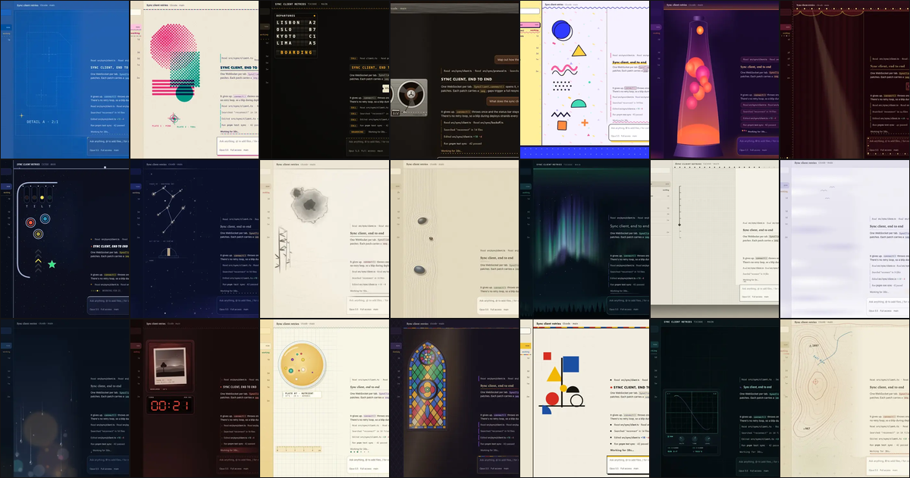

# Themes for T3 Code

21 living themes for [T3 Code](https://github.com/pingdotgg/t3code). Each one moves while your agent works and settles when the turn ends.

**[Browse and preview them all](https://joshsaintjacque.github.io/t3code-themes/)**

[](https://joshsaintjacque.github.io/t3code-themes/)

| Theme | Mood | Mode | While your agent works | Links |
|---|---|---|---|---|
| **Blueprint** | Creative | Dark | A pen plotter inks a part in the margin | [Page](https://joshsaintjacque.github.io/t3code-theme-blueprint/) · [Repo](https://github.com/joshsaintjacque/t3code-theme-blueprint) |
| **Misprint** | Energetic | Light | Two ink plates slip out of register | [Page](https://joshsaintjacque.github.io/t3code-theme-misprint/) · [Repo](https://github.com/joshsaintjacque/t3code-theme-misprint) |
| **Departures** | Energetic | Dark | A split-flap board rattles to BOARDING | [Page](https://joshsaintjacque.github.io/t3code-theme-departures/) · [Repo](https://github.com/joshsaintjacque/t3code-theme-departures) |
| **Reel to Reel** | Energetic | Dark | VU needles bounce and the reels turn | [Page](https://joshsaintjacque.github.io/t3code-theme-reel-to-reel/) · [Repo](https://github.com/joshsaintjacque/t3code-theme-reel-to-reel) |
| **Squiggle** | Energetic | Light | Memphis confetti bobs and tumbles | [Page](https://joshsaintjacque.github.io/t3code-theme-squiggle/) · [Repo](https://github.com/joshsaintjacque/t3code-theme-squiggle) |
| **Molten** | Energetic | Dark | Wax lamps heat up and rise | [Page](https://joshsaintjacque.github.io/t3code-theme-molten/) · [Repo](https://github.com/joshsaintjacque/t3code-theme-molten) |
| **Marquee** | Energetic | Dark | House lights dim and the bulbs chase | [Page](https://joshsaintjacque.github.io/t3code-theme-marquee/) · [Repo](https://github.com/joshsaintjacque/t3code-theme-marquee) |
| **Tilt** | Energetic | Dark | Pinball lights run and the score counts up | [Page](https://joshsaintjacque.github.io/t3code-theme-tilt/) · [Repo](https://github.com/joshsaintjacque/t3code-theme-tilt) |
| **Observatory** | Calm | Dark | Star plates draw while a reticle tracks | [Page](https://joshsaintjacque.github.io/t3code-theme-observatory/) · [Repo](https://github.com/joshsaintjacque/t3code-theme-observatory) |
| **Washi** | Calm | Light | Ink blooms, and a seal stamps at the end | [Page](https://joshsaintjacque.github.io/t3code-theme-washi/) · [Repo](https://github.com/joshsaintjacque/t3code-theme-washi) |
| **Sandgarden** | Calm | Light | A rake draws furrows around the stones | [Page](https://joshsaintjacque.github.io/t3code-theme-sandgarden/) · [Repo](https://github.com/joshsaintjacque/t3code-theme-sandgarden) |
| **Aurora** | Calm | Dark | Curtains of light swell overhead | [Page](https://joshsaintjacque.github.io/t3code-theme-aurora/) · [Repo](https://github.com/joshsaintjacque/t3code-theme-aurora) |
| **Folio** | Calm | Light | E-paper dots fill in whole steps | [Page](https://joshsaintjacque.github.io/t3code-theme-folio/) · [Repo](https://github.com/joshsaintjacque/t3code-theme-folio) |
| **Fogbank** | Calm | Light | A lighthouse beam sweeps through mist | [Page](https://joshsaintjacque.github.io/t3code-theme-fogbank/) · [Repo](https://github.com/joshsaintjacque/t3code-theme-fogbank) |
| **Rainglass** | Calm | Dark | Rain thickens on a night window | [Page](https://joshsaintjacque.github.io/t3code-theme-rainglass/) · [Repo](https://github.com/joshsaintjacque/t3code-theme-rainglass) |
| **Darkroom** | Creative | Dark | A print develops under the safelight | [Page](https://joshsaintjacque.github.io/t3code-theme-darkroom/) · [Repo](https://github.com/joshsaintjacque/t3code-theme-darkroom) |
| **Agar** | Creative | Light | Colonies grow on culture plates | [Page](https://joshsaintjacque.github.io/t3code-theme-agar/) · [Repo](https://github.com/joshsaintjacque/t3code-theme-agar) |
| **Clerestory** | Creative | Dark | Stained glass kindles and light shafts cross | [Page](https://joshsaintjacque.github.io/t3code-theme-clerestory/) · [Repo](https://github.com/joshsaintjacque/t3code-theme-clerestory) |
| **Primary** | Creative | Light | Bauhaus shapes recompose | [Page](https://joshsaintjacque.github.io/t3code-theme-primary/) · [Repo](https://github.com/joshsaintjacque/t3code-theme-primary) |
| **Phosphor** | Creative | Dark | An oscilloscope traces Lissajous figures | [Page](https://joshsaintjacque.github.io/t3code-theme-phosphor/) · [Repo](https://github.com/joshsaintjacque/t3code-theme-phosphor) |
| **Contour** | Creative | Light | Map contours shift, and a pin drops at the end | [Page](https://joshsaintjacque.github.io/t3code-theme-contour/) · [Repo](https://github.com/joshsaintjacque/t3code-theme-contour) |

## Install a theme

Open a theme's page or repository, download its JSON file, then run:

```sh
~/.t3/bin/t3 theme set <theme>.json
```

This sets it as the theme for your T3 environment.

## Update this gallery

`themes.json` drives the page and this README. To refresh it from local theme checkouts:

```sh
python3 source/collect.py <dir-with-checkouts>
python3 source/build.py
```

Independent themes, not affiliated with T3 Code. MIT licensed.
